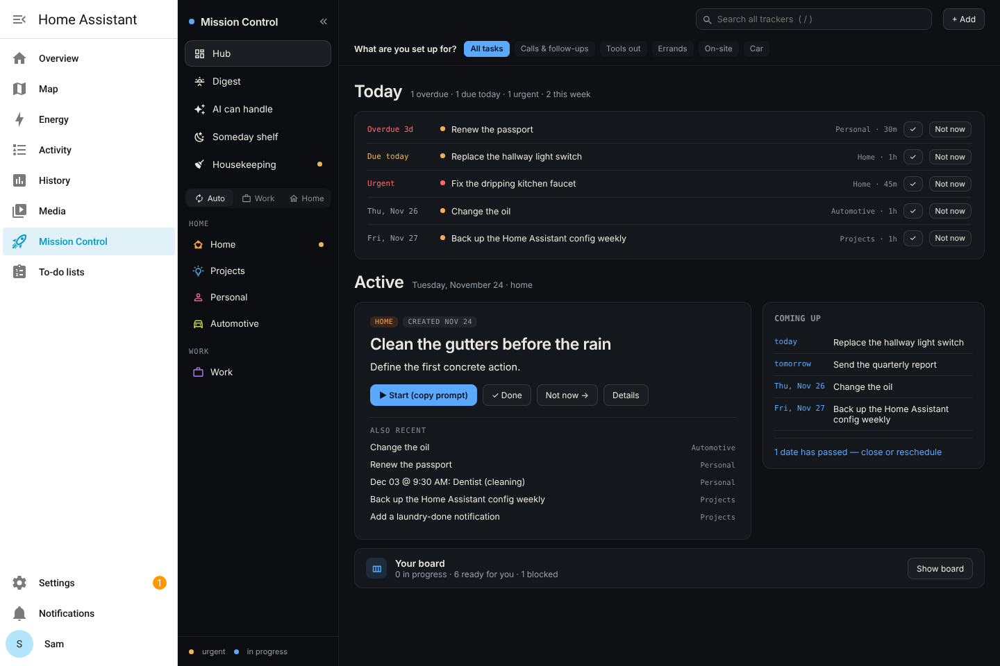
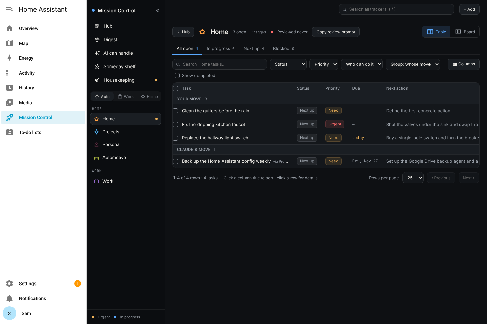
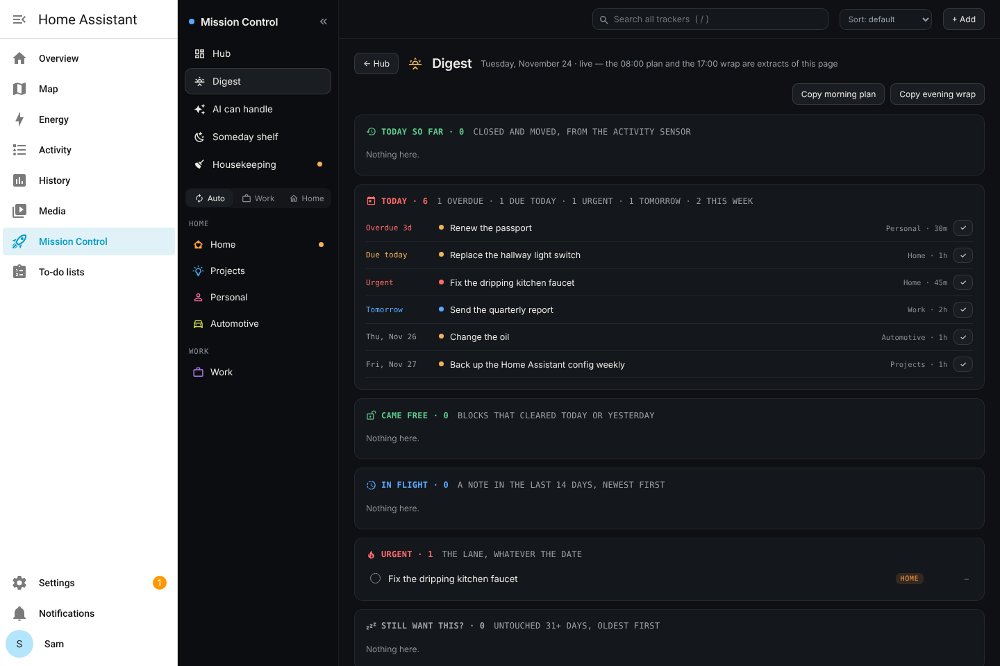

# Mission Control

A project board for Home Assistant. Everything you mean to get done around the house, at work
and in life sits on one board, in the sidebar, with a short answer to *what do I do now?*
Cards live in Home Assistant's own database file, show up as to-do lists on your phone, and
can be added by voice or by an AI that files a plain-language note for you.



## What you get

- **A sidebar panel** (`/mission-control`): a hub with *Today* (overdue → due today → urgent →
  tomorrow → this week), the card you touched last, what's coming up, and a page per branch
  with a table or board, grouped by whose move it is.
- **Branches** you choose: it starts with Home, Projects, Personal, Work and Automotive.
  Each branch is also a to-do list (`todo.<branch>_tracker`), so the Home Assistant app on
  your phone can read and tick them.
- **Phone lists** that are queries, not copies: `todo.mission_today`,
  `todo.mission_this_week`, `todo.mission_ready_for_you`.
- **Quick add**: type or say a note; with an AI Task entity it becomes a filed card (branch,
  lane, toolbox, effort, cost, next step, due date), mixed notes are split, and duplicates are
  caught. Without one, the note becomes a plain card.
- **Waiting that clears itself**: `BLOCKED BY:` a card, a date or an order clears on its own.
- **Repeating cards**, **tags** across branches, **field history with undo**.
- **Two daily pushes** (optional): a morning plan and an evening wrap.
- **Due dates on a calendar** (optional).

| Branch page | Digest |
|---|---|
|  |  |

## Requirements

- Home Assistant 2026.10 or newer.
- Optional: an **AI Task** entity for quick add (any AI integration that provides one, e.g.
  OpenAI, Anthropic, Google Generative AI or Ollama).
- Optional: a **calendar** entity for due dates.

## Install

**HACS (recommended):** HACS → ⋮ → *Custom repositories* → add this repository's URL as type
*Integration* → install **Mission Control** → restart Home Assistant.

**Manual:** copy `custom_components/mission_control` into your `/config/custom_components/`
and restart Home Assistant.

## Set up

Settings → Devices & services → *Add integration* → **Mission Control**. Three optional
questions:

- **Your name** — accepted as `OWNER: <name>` on a card. Leave it empty to be "you".
- **AI Task entity** — files quick notes for you.
- **Calendar** — every open card with a due date gets an all-day event. Events you make by
  hand are never touched.

*Mission Control* appears in the sidebar straight away.

### Branches

Settings → Devices & services → Mission Control → **Configure**:

- **Add a branch** — name, icon, colour, and two switches: *work branch* (untagged cards
  count as work and weekday work hours bring them forward) and *the assistant can usually do
  this work* (cards default to the assistant's move instead of yours). *Quick-add keywords*
  help the add box guess the branch.
- **Edit a branch** — everything except its key (`todo.<key>_tracker` never changes).
- **Remove an empty branch** — move or delete its cards first.

## Using it

- **The card format** — a title, a due date, and a short description with header lines
  (`LANE`, `OWNER`, `TOOLBOX`, `EFFORT`, `COST`, `BLOCKED BY`, `TAGS`, `REPEAT`,
  `NEXT STEP`), details, and a dated progress log. The panel writes it for you; the full
  reference is in [docs/CARD_FORMAT.md](docs/CARD_FORMAT.md).
- **Lanes** — `urgent` is only for an undated safety, leak, electrical or money risk. A
  deadline is a due date, and the card rises on its own as the day nears.
- **Whose move** — `OWNER: me` or `OWNER: claude` (the AI assistant). Without it the board
  decides from the next step, the toolbox and the branch.
- **Copy prompt** on a card gives an AI session everything it needs to pick the card up, and
  asks it to leave one dated *Stopped / Next / Blocked* note when it finishes.

## Daily pushes and voice (optional)

[`packages/mission_control.yaml`](packages/mission_control.yaml) adds:

- a **morning plan** at 08:00 and an **evening wrap** at 17:00, sent to your phone and opening
  the Digest page when tapped;
- a **nightly export** to `/config/mission_control_backups`;
- **`script.mission_file_note`** — expose it to Assist to add cards by voice;
- **`script.mission_today`** — expose it to Assist to hear what's on today.

Copy it to `/config/packages/`, add `packages: !include_dir_named packages` under
`homeassistant:` in `configuration.yaml`, change the one line marked `EDIT` to your phone's
notify action, and restart.

## Optional modules: packages and shopping

Under Configure → *Settings and optional modules*. Both start switched off, and neither
fetches anything by itself — they are hooks you feed.

- **Package tracking** adds `sensor.packages_*` and `mission_control.order_upsert`. Anything
  can feed it: an automation, a webhook, an email parser. A card can wait for a delivery with
  `BLOCKED BY: order <number>`; it clears itself when that order is delivered. See
  [docs/examples/order_feed.yaml](docs/examples/order_feed.yaml) for a webhook feed.
- **Shopping list** adds `todo.mission_shopping`, `sensor.mission_shopping` and the
  `shopping_*` services (stores, per-store brands and sizes, "what do I buy at this store").
  It sits next to Home Assistant's own Shopping list rather than replacing it.

## Services

| Service | What it does |
|---|---|
| `mission_control.file_note` | Turn a note into a card (AI-filed when an AI Task entity is set). Returns what was filed. |
| `mission_control.digest` | Build the morning plan or evening wrap as `{title, message}`. Sends nothing. |
| `mission_control.export` | Write a JSON export of the board to `/config/mission_control_backups`. |
| `mission_control.order_upsert` / `order_update` / `orders_list` | Package module. |
| `mission_control.shopping_add` / `shopping_check` / `shopping_run` / `shopping_overview` | Shopping module. |
| `mission_control.import_from_todo`, `set_active` | Move existing to-do lists named `todo.<branch>_tracker` into the board. |

The panel talks to the WebSocket API (`mission_control/items/list`, `items/get`,
`items/update`, `notes/add`, `items/history`, `items/revert`, `config`), which AI sessions and
scripts can use too.

## Your data

- The board is one SQLite file, `/config/mission_control.db`. Home Assistant backups include
  it. The nightly export (package above) keeps the last 30 JSON copies.
- Nothing leaves your Home Assistant except through the AI Task entity you choose: when quick
  add files a note it sends the note, your open card titles and the device names in any room
  the note mentions.
- Schema changes so far only add columns, so your cards carry over between versions.

## Updating and removing

Update through HACS (or copy the folder again) and restart. Removing the integration removes
the sidebar entry and the to-do lists; the database file stays in `/config` until you delete
it.

## Tests

```bash
pip install -r requirements_test.txt
pip install home-assistant-frontend   # the version Home Assistant's frontend manifest pins
pytest -q
```

## License

MIT — see [LICENSE](LICENSE).
